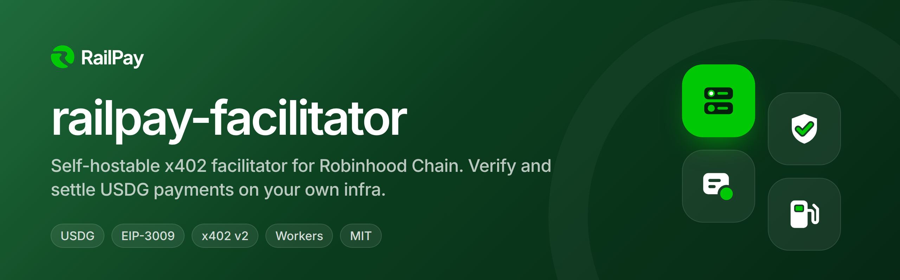

# railpay-facilitator

A self-hostable [x402](https://www.x402.org) v2 facilitator for [RailPay](https://railpay.app) on Robinhood Chain. It verifies and settles USDG payments with your own operator key, on Cloudflare Workers or Node.

- **One network, one token, one scheme:** USDG (Global Dollar, 6 decimals) on Robinhood Chain (chain id 4663), scheme `exact`, EIP-3009 `transferWithAuthorization`.
- **Checks before gas:** request shape, EIP-712 signature, exact recipient and amount, validity window, authorization nonce, payer balance, and a simulated transfer from the operator.
- **No double spend of your gas:** one authorization never gets two transactions from this facilitator, and never two success answers.
- **Operator protections:** amount limits, an optional `payTo` allowlist, rate limits per `payTo` and per IP, a low-gas pause, a gas price cap, and `GET /health`.

## What a facilitator is

In x402 a seller answers `402 Payment Required` with what it wants (amount, token, `payTo`). The buyer signs a payment, here an EIP-3009 `TransferWithAuthorization` for USDG, and retries with it. Someone then has to put that authorization on-chain and pay the gas. That is the **facilitator**: the seller sends it the payment, and the facilitator checks it (`/verify`), submits `transferWithAuthorization` from its own account (`/settle`) and returns the transaction hash.

The facilitator never holds the money. USDG goes from the payer straight to `payTo`; the facilitator's account, the **operator**, only pays the gas.

## Self-hosting vs Toll and Primer

The RailPay SDK seller uses two public facilitators by default, [Toll](https://x402.t0ll.xyz) and then [Primer](https://x402.primer.systems). Both are keyless for sellers and pay the gas themselves. Running this package instead:

| | Public facilitator (Toll, Primer) | This facilitator |
|---|---|---|
| Who pays the gas | They do | You do, from your operator key |
| Keys to manage | None | One hot key holding a little ETH |
| Limits | Theirs (Toll, as of November 2026: 0.001 to 100 USDG per payment, 60 per hour for an unverified `payTo`; check their docs) | Yours: amounts, allowlist, rate limits |
| Availability | Their uptime | Yours |
| What the seller trusts | Their answer, then the chain | Your answer, then the chain |

Either way a RailPay SDK seller reads the receipt and the exact USDG `Transfer` log from the chain before it serves anything, so a facilitator cannot fake a payment to it. You can also list yours first and a public one as fallback: `facilitators: ["https://your-facilitator", "https://x402.t0ll.xyz"]`.

What it costs: on an anvil fork of Robinhood Chain one settlement to a new `payTo` used about 102,000 gas, roughly 0.000002 ETH at a 0.02 gwei base fee. On Robinhood Chain itself the gas also covers the L1 data fee, so expect more.

## Quick start: Node

Node 22.13 or newer. You need an **operator key**: a fresh private key used only for this, holding a little ETH on Robinhood Chain. Never use a treasury or personal key.

```sh
git clone https://github.com/railpayapp/railpay-facilitator
cd railpay-facilitator
pnpm install                                  # also builds dist/
read -rs OPERATOR_KEY; export OPERATOR_KEY    # paste the key, nothing is echoed
RPC_URL=https://… pnpm start                  # node dist/node.js on http://127.0.0.1:8787
```

```sh
curl -s http://127.0.0.1:8787/health
```

Settlement records go to `./railpay-facilitator.db` (SQLite) so a restart can finish what was in flight. Run **one process per operator key**. Behind a reverse proxy set `TRUST_PROXY=1` so the per-IP limit sees the client, and `HOST=0.0.0.0` only if the proxy is on another machine.

## Quick start: Cloudflare Workers

The Worker routes every request to one Durable Object, `RailPayFacilitator`. That object is the single sender for the operator key, its SQLite storage is the settlement store, and the rate limits are global. `wrangler.json` in this repo is a working example: no routes, `workers_dev` on.

```sh
git clone https://github.com/railpayapp/railpay-facilitator
cd railpay-facilitator
pnpm install
pnpm dlx wrangler@4 secret put OPERATOR_KEY   # prompts for the value
pnpm dlx wrangler@4 secret put RPC_URL        # optional; a secret because provider URLs carry API keys
pnpm build && pnpm dlx wrangler@4 deploy
```

Check which Cloudflare account wrangler is logged into first (`wrangler whoami`): a `CLOUDFLARE_API_TOKEN` in your shell wins over your login. Settings other than the two secrets are `vars` in `wrangler.json`.

To deploy from your own Worker project instead of a fork, depend on the package and re-export it: see [`examples/worker`](examples/worker).

## Point a seller at it

```ts
import { createPaywall } from "railpay-sdk";

const paywall = createPaywall({
  payTo: "0xYourWallet",
  price: "0.01",
  facilitators: ["http://localhost:8787"],
});

// Any Fetch API framework: Hono, Workers, Bun, Deno, Next.js route handlers.
app.get("/quote", (c) => paywall.handle(c.req.raw, () => Response.json({ quote: 42 })));
```

Runnable versions: [`examples/seller.ts`](examples/seller.ts) (an SDK seller using your facilitator) and [`examples/embed.ts`](examples/embed.ts) (the facilitator inside your own Hono server, behind a bearer token).

## Configuration

Environment variables for Node, `vars` and secrets for Workers. Amounts are in USDG, ETH and gwei as decimals.

| Variable | Default | Meaning |
|---|---|---|
| `OPERATOR_KEY` | required | Operator private key, 64 hex characters, optional `0x`. Pays the gas. Never logged or returned. A secret on Workers |
| `RPC_URL` | `https://robinhood-rpc.publicnode.com` | Robinhood Chain JSON-RPC. Use your own provider in production. Never logged or returned, since it may hold an API key |
| `MIN_AMOUNT` | `0.001` | Smallest payment settled |
| `MAX_AMOUNT` | `100` | Largest payment settled |
| `PAY_TO_ALLOWLIST` | empty: any | Comma or space separated addresses. When set, only payments to these are verified and settled |
| `RATE_LIMIT_PAYTO_PER_HOUR` | `120` | New settlements per `payTo` per hour. `0` disables |
| `RATE_LIMIT_IP_PER_MINUTE` | `60` | `/verify` and `/settle` requests per client IP per minute. `0` disables |
| `MIN_OPERATOR_ETH` | `0.0005` | Settlement pauses while the operator holds less ETH than this |
| `MAX_FEE_PER_GAS_GWEI` | none | Refuse to send while the base fee is above this, and never offer a higher max fee |
| `MAX_GAS` | `300000` | Refuse to send when the gas estimate is above this |
| `VALIDITY_MARGIN_SECONDS` | `6` | `validBefore` must be at least this far ahead, at verification and again right before sending |
| `RECEIPT_TIMEOUT_MS` | `20000` | How long `/settle` waits for the receipt before answering `settlement_pending`. Minimum 1000 |
| `STORE` | `sqlite` | Node only: `sqlite` (survives restarts) or `memory` (lost on restart) |
| `SQLITE_PATH` | `./railpay-facilitator.db` | Node only: SQLite file for settlement records |
| `TRUST_PROXY` | off | Node only: take the client IP from the last `X-Forwarded-For` entry. Set it only behind one reverse proxy you run. Workers use `CF-Connecting-IP` |
| `PORT` | `8787` | Node only: listen port |
| `HOST` | `127.0.0.1` | Node only: listen address |

A bad value stops the server at start with the variable's name, never its value.

## API

Bodies follow the [x402 v2 specification](https://github.com/coinbase/x402/blob/main/specs/x402-specification-v2.md), section 7. Error codes are always from its section 9.

| Route | |
|---|---|
| `POST /verify` | Check a payment. Writes nothing, sends nothing |
| `POST /settle` | Verify again, send `transferWithAuthorization`, confirm the transfer |
| `GET /supported` | Scheme, network and the operator address |
| `GET /health` | Operator ETH and whether settlement is open. Not in the spec |
| `GET /` | Name, version, network, operator and limits |

Other methods answer `405` with `Allow`. Malformed JSON answers `400`, a body over 16 KiB `413`, both in the endpoint's response shape.

### `POST /verify`

```json
{ "x402Version": 2, "paymentPayload": { "...": "..." }, "paymentRequirements": { "...": "..." } }
```

Answers `200` with `{ "isValid": true, "payer": "0x…" }` or `{ "isValid": false, "invalidReason": "…", "invalidMessage": "…", "payer": "0x…" }`. `invalidMessage` is a readable explanation: not in the spec's table, and the x402 reference implementation uses the same field.

Checks, in order:

1. **Request:** x402 version 2; scheme `exact`; network `eip155:4663`; asset USDG with `extra.name` `"Global Dollar"` and `extra.version` `"1"`; `accepted` equal to the requirements; field formats.
2. **Policy:** amount within `MIN_AMOUNT` to `MAX_AMOUNT`, `payTo` on the allowlist when one is set (`invalid_payment_requirements`); payer different from `payTo` (`invalid_payload`).
3. **Authorization:** `to` = `payTo`; `value` = `amount` exactly; `validAfter` ≤ now; `validBefore` ≥ now + margin.
4. **Signature:** the EIP-712 `TransferWithAuthorization` signature recovers to `authorization.from`.
5. **Chain:** chain id 4663; `authorizationState(from, nonce)` unused; payer balance ≥ `value`; an `eth_call` of `transferWithAuthorization` from the operator succeeds. A revert maps to `insufficient_funds`, `invalid_exact_evm_payload_signature`, or `invalid_transaction_state` with the reason in `invalidMessage`. An RPC failure answers `unexpected_verify_error`.

The chain is read only after the offline checks pass. An authorization this facilitator is settling or has settled is refused with `invalid_payload`.

### `POST /settle`

Same request body. Answers the spec's `SettleResponse`:

```json
{ "success": true, "transaction": "0x…", "network": "eip155:4663", "payer": "0x…", "amount": "10000" }
{ "success": false, "errorReason": "…", "errorMessage": "…", "transaction": "", "network": "eip155:4663", "payer": "0x…" }
```

What happens:

1. Every `/verify` check runs again.
2. Operator guards: at least `MIN_OPERATOR_ETH`, and the `payTo` under its hourly limit.
3. The authorization is **claimed** in the store with an atomic insert. A concurrent or repeated call stops here.
4. One sender at a time per operator key: estimate gas (≤ `MAX_GAS`), read EIP-1559 fees (max fee = 2 × base fee + priority fee, capped by `MAX_FEE_PER_GAS_GWEI`) and the pending nonce, check the operator can pay `gas × maxFee`, sign.
5. The signed transaction and its hash are **stored before broadcast**, so the store knows any hash that may be on the wire.
6. Broadcast and wait for the receipt. Success needs status 1 **and** exactly one USDG `Transfer(payer → payTo, amount)` log.

| Outcome | HTTP | Body |
|---|---|---|
| Confirmed with the exact transfer | 200 | `success: true`, `transaction` |
| A check failed | 200 | `success: false`, the spec code, `transaction: ""` |
| Broadcast, not confirmed yet | 200 | `settlement_pending`, `transaction` = the hash |
| Mined but reverted, or without the exact `Transfer` log | 200 | `invalid_transaction_state`, `transaction` = the hash. Final |
| Already settled by this facilitator | 200 | `invalid_payload`, the hash in `errorMessage` |
| Being settled right now by another call | 200 | `invalid_transaction_state`, nothing sent. Retry for the result |
| Too many settlements to this `payTo`, or requests from this IP | 429 + `Retry-After` | `unexpected_settle_error`, nothing sent |
| Low operator ETH, estimate over `MAX_GAS`, base fee over the cap, queue busy, RPC unreadable | 503 + `Retry-After` | `unexpected_settle_error`, nothing sent |
| The RPC refused the transaction | 502 | `unexpected_settle_error`, the claim is released |

**Retrying is safe.** Calling `/settle` again with the same payload after `settlement_pending`, a timeout or a restart reconciles instead of sending anew: it looks for the receipt, rebroadcasts the **identical signed bytes** (same hash) and waits again. A new transaction is sent only when the old one provably can never be mined, because another transaction took its operator nonce, and then by one caller only. If the chain clock passes `validBefore` first, the answer is `invalid_exact_evm_payload_authorization_valid_before`; mined later, the token reverts it and nothing moves.

A success answer is handed out once per authorization.

### `GET /health`

`200` while settlement is open, `503` while it is paused, so an uptime monitor can alert before the operator runs dry.

```json
{
  "ok": true,
  "version": "0.5.0",
  "network": "eip155:4663",
  "chainId": 4663,
  "rpcChainId": 4663,
  "asset": "0x5fc5360D0400a0Fd4f2af552ADD042D716F1d168",
  "operator": "0x…",
  "ethBalance": "1000000000000000",
  "minEthBalance": "500000000000000",
  "canSettle": true
}
```

When paused, `ok` and `canSettle` are false and `reason` says why: low ETH, RPC unreachable, or RPC on another chain. Balances are in wei. Cached for 5 seconds.

### `GET /supported`

```json
{ "kinds": [{ "x402Version": 2, "scheme": "exact", "network": "eip155:4663" }], "extensions": [], "signers": { "eip155:*": ["0xOperator…"] } }
```

## Stores and instances

The store remembers each authorization this facilitator touched: claimed, submitted with its signed transaction, settled or failed.

| Store | Survives restart | Several instances |
|---|---|---|
| `memoryStore()` | no | no: one process |
| `sqliteStore(path)`, `railpay-facilitator/sqlite` (Node) | yes | claims are atomic across processes on one file, but run one Node process per operator key: the nonce sender lives in the process |
| Durable Object (Workers) | yes | yes: every request goes to the one object, which is the only sender |

Whatever the store, an authorization lands on-chain at most once: the token checks its nonce. The store is what keeps this facilitator from paying gas for duplicates and from answering success twice. For more throughput on Node, run several processes with **different operator keys**, each with its own store.

## Library

```ts
import { createApp, createFacilitator } from "railpay-facilitator";
import { sqliteStore } from "railpay-facilitator/sqlite";        // Node
// import { RailPayFacilitator, durableObjectStore } from "railpay-facilitator/worker";

const facilitator = createFacilitator({
  operatorKey: process.env.OPERATOR_KEY as `0x${string}`,
  rpcUrl: process.env.RPC_URL,
  store: sqliteStore("./settlements.db"),
  payToAllowlist: ["0xYourSeller"],
});

await facilitator.verify(paymentPayload, paymentRequirements); // VerifyResponse
await facilitator.settle(paymentPayload, paymentRequirements); // SettleResponse
await facilitator.health();                                    // HealthResponse
const app = createApp(facilitator);                            // a Hono app: app.fetch(request)
```

`loadConfig(env)` turns the variables above into options.

## Security model and operator risks

**The operator key.** It signs one kind of transaction: `transferWithAuthorization` on USDG with `value: 0`. It cannot move anyone's USDG without their signature, and it holds none. What it can lose is its ETH. Use a fresh key, keep only a few days of gas on it, and store it as a secret (`wrangler secret`, a secret manager, `read -rs`), never in a file in the repo. To rotate: fund a new key, switch, wait until nothing is `settlement_pending`, then move the old key's ETH out.

**Gas griefing.** `/verify` and `/settle` have no authentication. Anyone who can reach them can make the operator pay gas for any valid payment within your limits. Each payment costs the caller the payment itself, so the cheap abuse is many `MIN_AMOUNT` payments between wallets they control. Defenses, strongest first:

- `PAY_TO_ALLOWLIST` set to your own sellers: then only payments to you get settled.
- A token in front of `/verify` and `/settle` ([`examples/embed.ts`](examples/embed.ts)), or a private network.
- A higher `MIN_AMOUNT`, the per-`payTo` and per-IP limits, and little ETH on the key.

**Reverts still cost gas.** Gas is spent only after every check and a successful simulation, but the payer can still move their USDG, or the same authorization can be settled by someone else, between the simulation and the block. That transaction reverts, the gas is gone, and the answer says `invalid_transaction_state`.

**Stuck transactions.** The max fee is twice the base fee when signed. If the base fee rises above that, the transaction waits, and later settlements queue behind its nonce. Retries rebroadcast the same bytes; there is no fee bumping. `MAX_FEE_PER_GAS_GWEI` stops sending during a spike instead of signing at any price.

**The RPC.** The facilitator believes its RPC about balances, nonces and receipts. Use a provider you trust. Sellers using the RailPay SDK check the chain again through their own RPC.

**Rate limits** are in memory: per process on Node, global on Workers. They reset on restart. The per-IP limit is only as good as the client IP: on Node, set `TRUST_PROXY` only behind your own proxy, or anyone can pick their IP with a header.

**What is logged.** One JSON line per settlement event with payer, `payTo`, amount and transaction hash. Never the key, the RPC URL or the raw transaction.

Found something? See [SECURITY.md](SECURITY.md).

## Known limitations

- EOA payers only: the signature must recover to `authorization.from`. Smart contract wallets (EIP-1271) are not supported.
- One transaction at a time per operator key, each waiting for its receipt. Throughput is about one settlement per block per key.
- No fee bumping or replacement of a pending transaction.
- No built-in authentication on the endpoints. See the embed example.
- A repeated `/settle` for an already settled authorization answers `invalid_payload` with the hash in `errorMessage`, not a second `success: true`. That is deliberate: one success per authorization.
- After a transaction is proven dead, the new one is sent on the next `/settle` call; nothing retries in the background.

## How it relates to the RailPay relayer

Today RailPay's own x402 settlement goes through the public facilitators (Toll, then Primer). The **RailPay relayer**, a RailPay-run key that will pay gas for agent-to-agent payments and withdrawals in the RailPay app, is **coming soon** and is not live.

This package is separate from both. It is for anyone who wants their own settlement for RailPay-style USDG payments: it does not need the relayer, the relayer does not need it, and neither the RailPay app nor the SDK uses it unless you point `facilitators` at it.

## Development

```sh
pnpm install
pnpm typecheck && pnpm test && pnpm build
pnpm smoke                                          # read-only checks against Robinhood Chain (publicnode)
ANVIL_BIN=~/.foundry/bin/anvil pnpm test:fork       # optional: settle on a local anvil fork
```

`pnpm test` needs no network. It signs real EIP-3009 authorizations and operator transactions with throwaway keys and runs them against an in-memory chain (a viem custom transport) that mines, reverts, drops and rebroadcasts transactions. Suites cover every verify failure, concurrent and repeated settles, reconcile after timeouts and restarts, limits, health, the HTTP shapes, the Workers entry with its Durable Object store, and the real `railpay-sdk` seller (`createPaywall`) settling through this facilitator.

`pnpm smoke` sends nothing and needs no funded key: chain id, USDG `name()` and `DOMAIN_SEPARATOR`, `authorizationState`, a reverting simulation from an empty wallet, `verify`, and `health` for an unfunded operator.

`pnpm test:fork` starts anvil on a fork of Robinhood Chain, funds throwaway wallets by editing the fork's storage, and settles real transactions on it. Nothing is sent to the real chain.

```
src/
  facilitator.ts   verify, settle, reconcile, health
  parse.ts         request shape checks
  chain.ts         JSON-RPC calls, revert decoding, Transfer log matching
  store.ts         settlement records: memory and SQL stores
  limits.ts        rate limiter and the sender queue
  app.ts           Hono HTTP API
  config.ts        environment variables
  node.ts          Node server (dist/node.js)
  sqlite.ts        node:sqlite store
  worker.ts        Workers entry and Durable Object
```

## Links

- Website: https://railpay.app
- Docs: https://docs.railpay.app
- Dapp: https://dapp.railpay.app
- SDK: https://github.com/railpayapp/railpay-sdk
- MCP server: https://github.com/railpayapp/railpay-mcp
- X: https://x.com/railpayapp

## License

[MIT](LICENSE)
